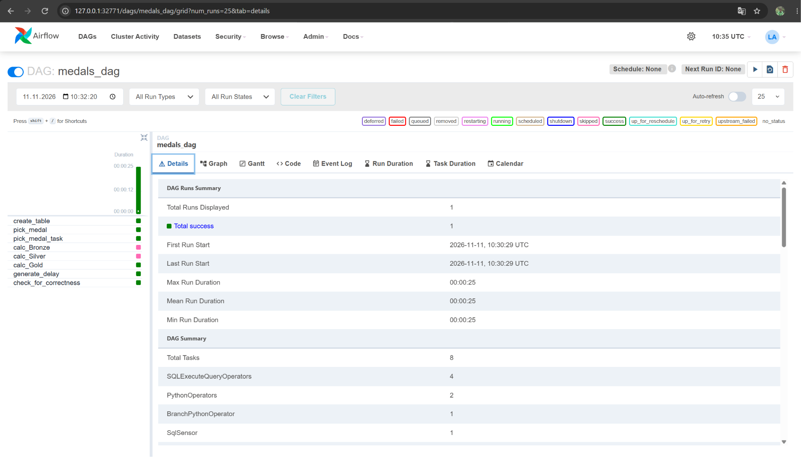
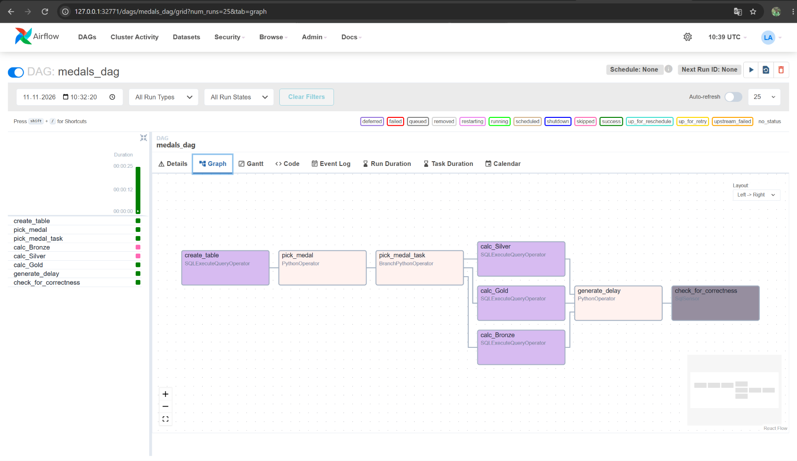
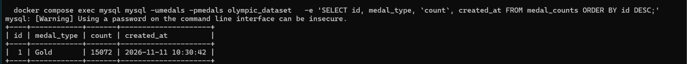
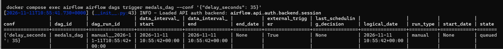
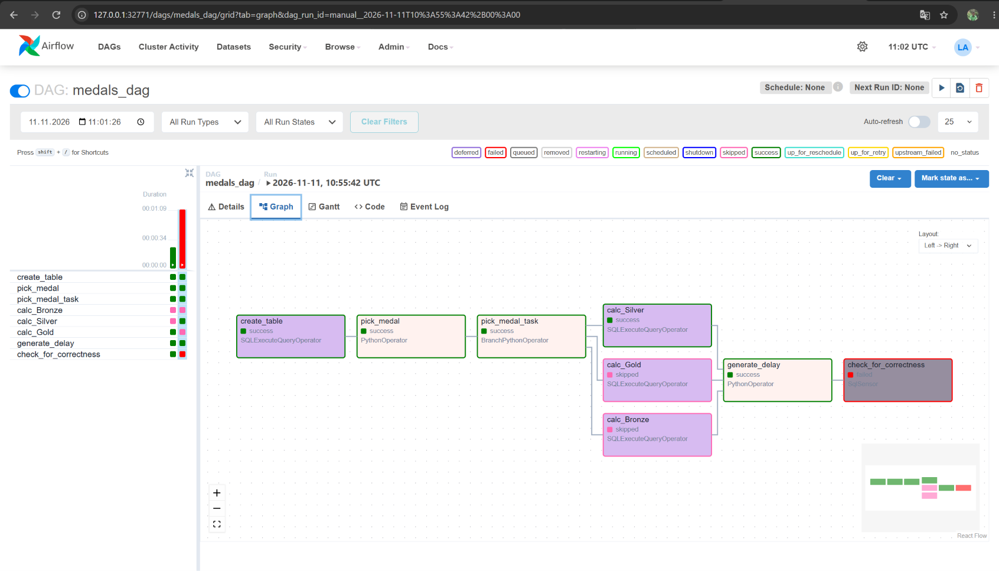
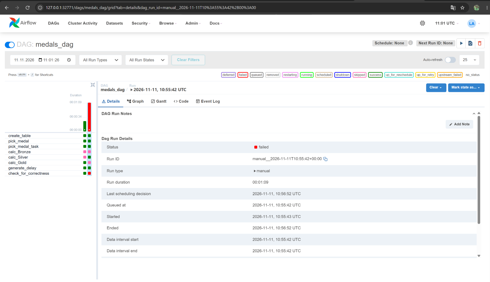

# Medal counts pipeline

A local Airflow and MySQL pipeline that imports a CSV, randomly selects a medal,
counts matching records, and checks that the result is fresh.

## Run

Requires Docker Engine with Docker Compose v2 and approximately 4 GB of available
memory. The initial build needs internet access.

```bash
cp .env.example .env
```

Edit `.env` and replace `DATA_URL=your_data_url` with a direct URL to your CSV
(for example, `DATA_URL=https://example.com/medals.csv`). Compose reads `.env`
automatically; an exported shell variable takes precedence. Use a direct CSV download URL.

The CSV must be UTF-8, have unique column names containing only letters, digits,
and underscores (starting with a letter or underscore), and include a `medal`
column with at least one `Bronze`, `Silver`, or `Gold` value. Rows represent records
to count; the pipeline does not deduplicate athletes or events.

Alternatively, place your CSV at `data/athlete_event_results.csv`. A local file
has priority over `DATA_URL` and does not require a configured URL.

```bash
docker compose up -d --build
docker compose ps -a
docker compose logs -f import-data airflow-init airflow
```

Exit log viewing with Ctrl+C. Successful `import-data` and `airflow-init` services
show `Exited (0)`. Airflow uses an automatically assigned free host port
(`AIRFLOW_PORT=0`). Find its address with:

```bash
docker compose port airflow 8080
```

Open `http://<returned-address>` in your browser (for example,
`http://127.0.0.1:49152`) and sign in with `admin` / `admin`.
MySQL uses an automatically assigned free host port (`MYSQL_PORT=0`). Find it with:

```bash
docker compose port mysql 3306
```

Use the returned address and port in your SQL client. Airflow connects directly to
`mysql:3306` within the Docker network. The assigned host port may change when the
container is recreated. Set `MYSQL_PORT` in `.env` to a specific port if needed.
Airflow ports can also change when the container is recreated. Set `AIRFLOW_PORT`
in `.env` to a specific port if needed.

Trigger `medals_dag` in the UI, or run:

```bash
docker compose exec airflow airflow dags trigger medals_dag --conf '{"delay_seconds": 5}'
docker compose exec airflow airflow dags list-runs -d medals_dag
docker compose exec mysql mysql -umedals -pmedals olympic_dataset -e 'SELECT * FROM medal_counts ORDER BY id DESC;'
```

Wait for the run to finish before querying the result. One `calc_*` task runs,
the other two are skipped, and the freshness sensor should succeed. A delay of
35 seconds can be used to demonstrate a freshness check failure.

## Troubleshooting and lifecycle

```bash
docker compose exec airflow airflow dags list-import-errors
docker compose logs import-data airflow-init
docker compose down
```

An unset or placeholder `DATA_URL` fails with instructions when no local CSV is
available. Correct the configuration and repeat `docker compose up -d --build`.
A populated source table is reused on later starts; changing the URL does not
replace an existing dataset.

Docker volumes retain MySQL data and Airflow history. To discard all local data
and import again, run `docker compose down -v` before starting the services.

This setup uses SQLite and SequentialExecutor for Airflow metadata and execution.
It runs one DAG at a time and uses fixed local development credentials. MySQL
stores the source data and results. Both exposed ports bind to localhost.

## Files

- `compose.yaml`: MySQL, CSV importer, Airflow initialization, scheduler and UI.
- `Dockerfile`: Airflow 2.10.5 with the MySQL provider and PyMySQL.
- `medals_dag.py`: table creation, medal selection, branching and freshness check.
- `scripts/import_data.py`: CSV validation and batched import.
- `scripts/init.sh`: metadata migration and local UI user creation.
- `.env.example`: URL and host port configuration template.

## Recorded results

The recorded runs demonstrate both successful processing and an intentional
freshness check failure. The screenshots below come from the local execution;
random medal selection can produce different medals in later runs.

### Successful run

The run completed successfully in 25 seconds. The Gold branch ran, the Bronze
and Silver branches were skipped, and the delay and freshness sensor succeeded.



The graph below shows the task dependencies. The Grid screenshot above shows
the successful run states.



### Stored result

The source table is `olympic_dataset.athlete_event_results`. The selected Gold
branch stored a count of **15,072** in `medal_counts`, with an automatically
assigned ID and a creation timestamp.



### Intentional freshness failure

A separate run was triggered with `delay_seconds` set to **35**. This exceeds
the sensor's 30-second freshness window.



In that run, the Silver branch and delay succeeded, the other medal branches
were skipped, and `check_for_correctness` failed. The run finished with status
`failed`, as expected for this scenario.




